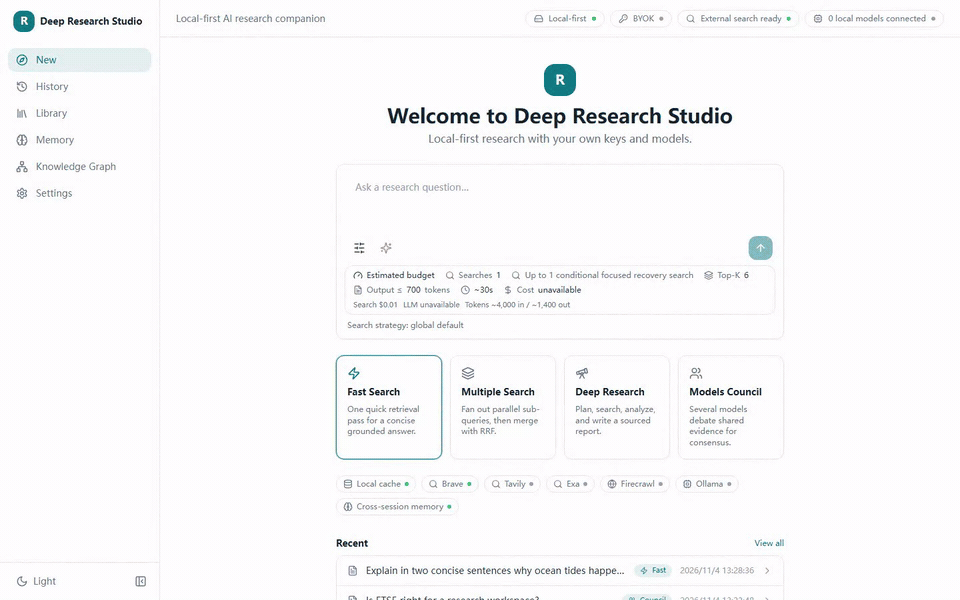
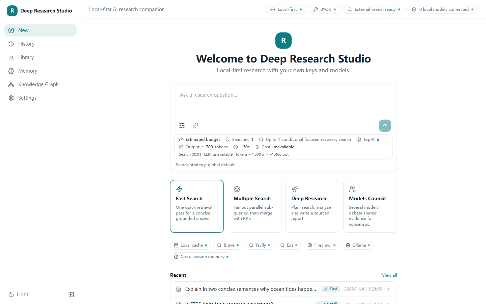
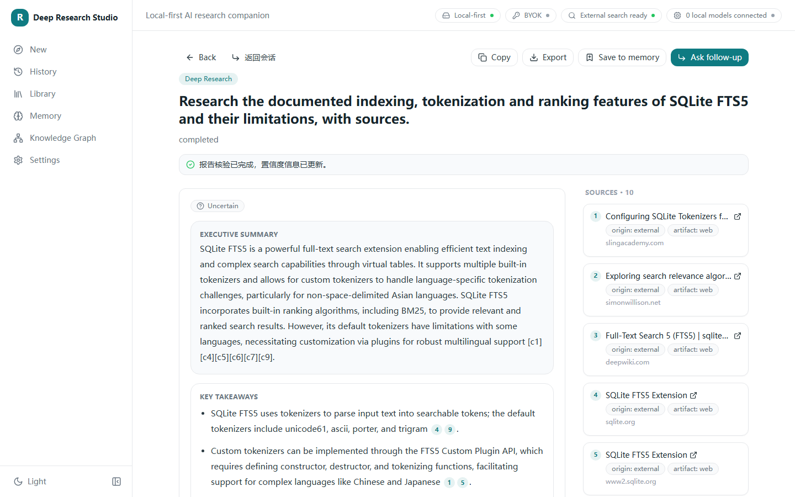
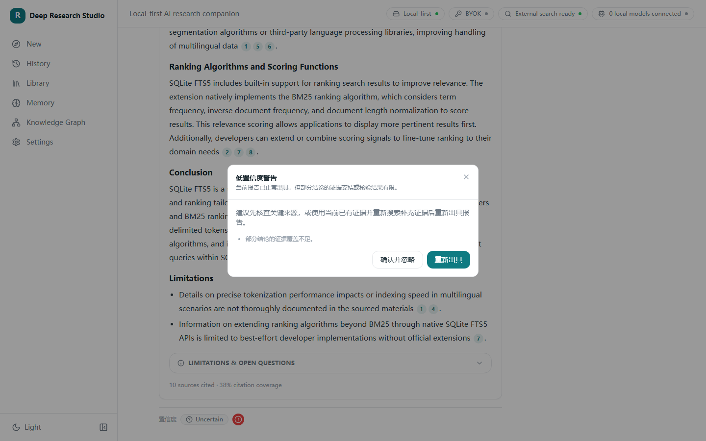
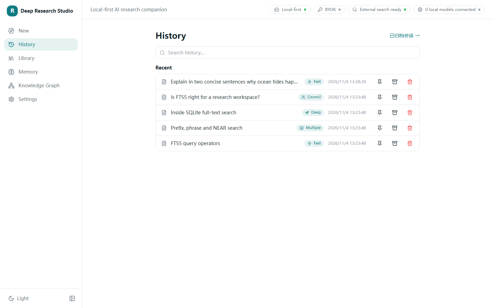
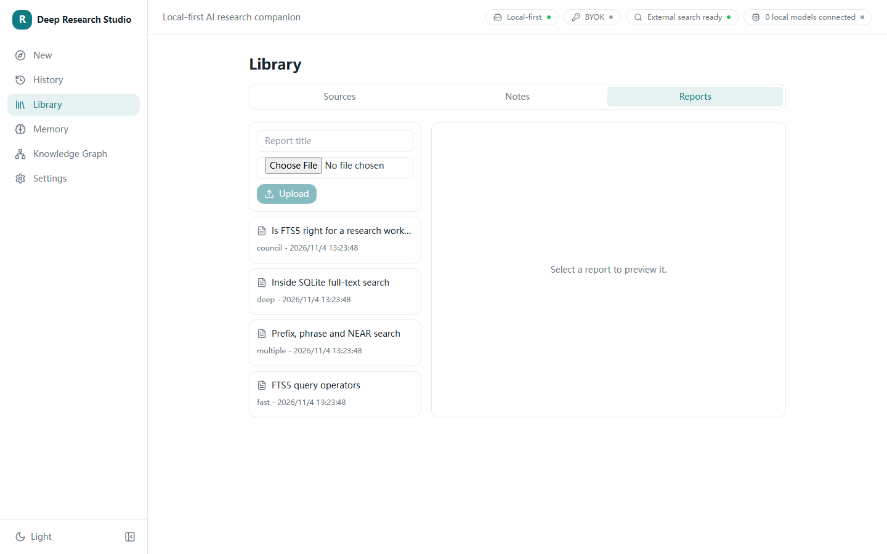
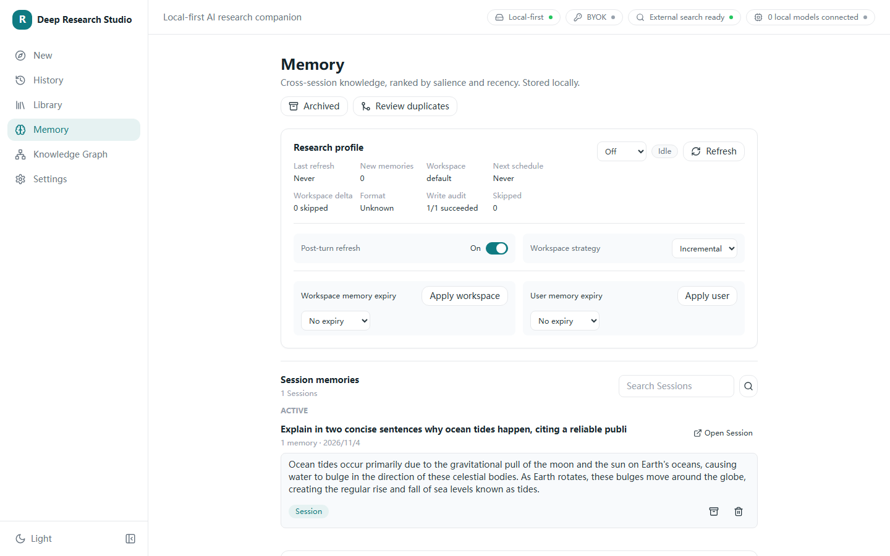
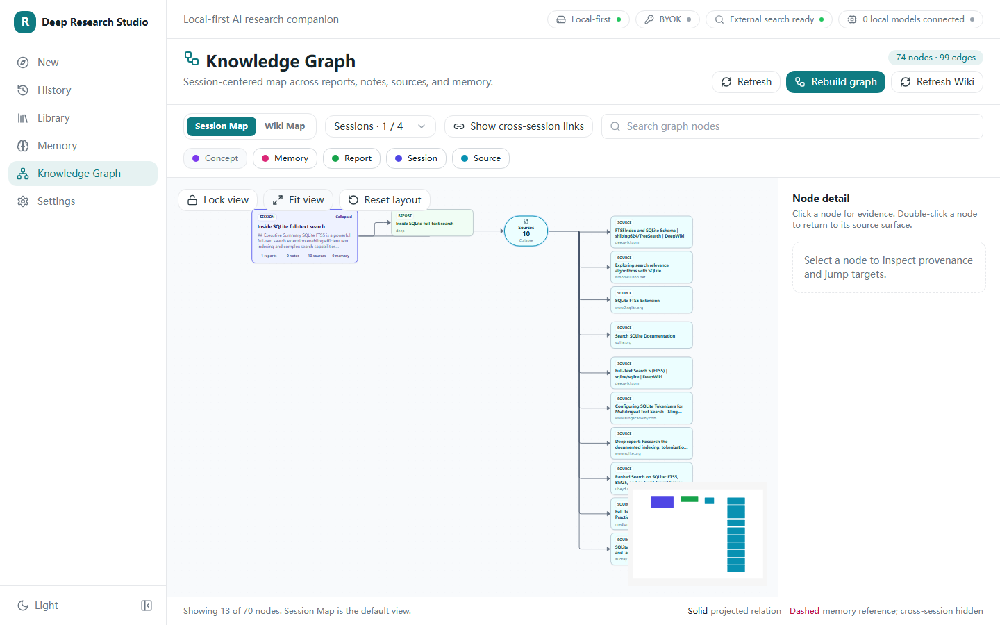
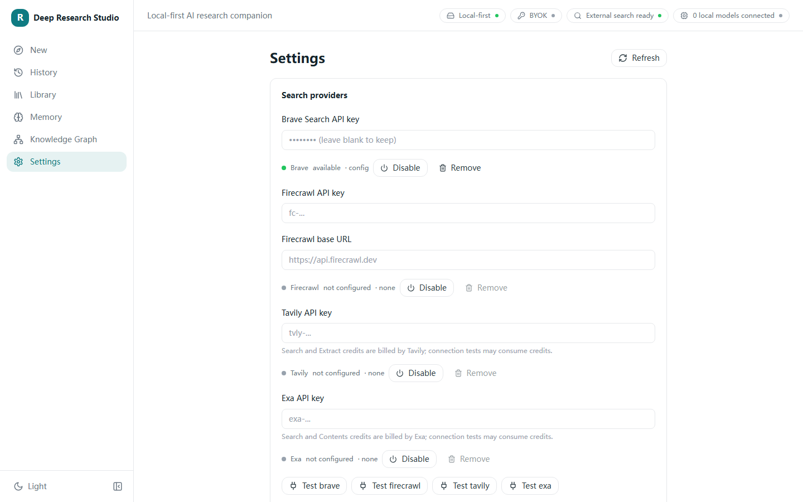
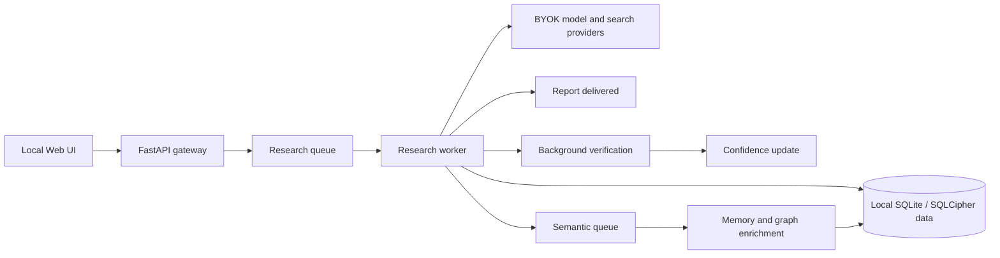

<div align="center">

[English](README.md) · [简体中文](README.zh-CN.md)


# Deep Research Studio

**A local-first, bring-your-own-key research workspace for sourced answers, structured reports, memory, and knowledge exploration.**

[](https://github.com/Moonaria123/Deep-Research-Studio/releases/latest)
[](https://github.com/Moonaria123/Deep-Research-Studio/actions/workflows/verify.yml)
[](LICENSE)
[](#what-you-can-do)
[](docs/deployment.md)
[](#privacy-and-security)
[](#privacy-and-security)
[](https://moonaria123.github.io/Deep-Research-Studio/)

[Open the interface-only Demo](https://moonaria123.github.io/Deep-Research-Studio/) · [Install locally](docs/deployment.md) · [Security](SECURITY.md)

</div>

> [!NOTE]
> The hosted Demo uses fixed, sanitised results. It has no provider keys, cannot call models or search services, and does not save visitor input. Use a local installation for real research.

<a href="docs/media/demo-60s.mp4">
  
</a>

*Click the animation to watch the complete 60-second interface tour.*

## Contents

- [Why Deep Research Studio](#why-deep-research-studio)
- [What you can do](#what-you-can-do)
- [Interface gallery](#interface-gallery)
- [Install](#install)
- [How it works](#how-it-works)
- [Privacy and security](#privacy-and-security)
- [Roadmap](#roadmap)
- [Contributing and licence](#contributing-and-licence)

## Why Deep Research Studio

Deep Research Studio keeps the research workflow in one local Web application. Choose the depth of work, connect your own model and search providers, follow research progress, inspect claim-level sources, and keep useful reports, notes, memories, and topic relationships close to the evidence that created them.

The report is delivered as soon as writing completes. Verification continues in the background and updates the confidence indicator when it finishes. A low-confidence result remains available: you can inspect the warning, accept the risk, or ask the application to research again using the current evidence plus a new search.

## What you can do

| Mode | Designed for |
| --- | --- |
| **Fast Search** | A concise, sourced answer from one focused retrieval pass. |
| **Multiple Search** | Parallel sub-queries merged into a broader evidence view. |
| **Deep Research** | A planned, multi-stage investigation and structured report. |
| **Models Council** | Multiple models examining shared evidence before a consensus report. |

Across the four modes, the Gen1 Web release provides:

- report-first delivery with background verification and live confidence updates;
- claim-level citations, source inspection, research progress, and report export;
- a Library for imported sources, saved reports, and notes;
- session history, archives, and follow-up research;
- optional automatic Memory writing and semantic recall;
- session and Wiki-style knowledge maps generated from local research data;
- local provider, retrieval, context-budget, Memory, and graph settings;
- encrypted provider credential storage and local-only deployment defaults.

## Interface gallery

<details open>
<summary><strong>Start a research run</strong></summary>



Choose a mode, evidence scope, Memory use, and model options from one workspace.
</details>

<details>
<summary><strong>Read a sourced report and its confidence</strong></summary>



Read the report immediately while verification continues, then inspect citations and confidence details.


</details>

<details>
<summary><strong>Return to prior research</strong></summary>



Pin, archive, restore, and continue research sessions.
</details>

<details>
<summary><strong>Organise sources, reports, and notes</strong></summary>


</details>

<details>
<summary><strong>Inspect and manage Memory</strong></summary>


</details>

<details>
<summary><strong>Explore topic relationships</strong></summary>


</details>

<details>
<summary><strong>Configure local providers and research behaviour</strong></summary>


</details>

## Install

Deep Research Studio supports two local Web deployment paths:

| Host | Requirements | Key protection |
| --- | --- | --- |
| **Windows + Docker Desktop** | Windows, Python 3.12, Docker Desktop with Linux containers | The root key is protected by the current Windows user's DPAPI context. |
| **Native Linux / WSL2 + Docker** | Python 3.12, Docker Engine with Compose v2 | The root key stays in an owner-only Linux directory and is injected into a memory-backed container volume at startup. |

Both paths build the API and Web images from this repository, bind the UI and API to localhost, and require an explicit data directory. Follow the tested commands in the [deployment and recovery guide](docs/deployment.md).

<details>
<summary><strong>Quick start — Windows + Docker Desktop</strong></summary>

```powershell
git clone https://github.com/Moonaria123/Deep-Research-Studio.git
Set-Location Deep-Research-Studio
py -3.12 scripts\start_gen1_web.py --initialize --build --data-dir D:\DeepResearchStudioData\main
```

</details>

<details>
<summary><strong>Quick start — native Linux / WSL2 + Docker</strong></summary>

```bash
git clone https://github.com/Moonaria123/Deep-Research-Studio.git
cd Deep-Research-Studio
python3 scripts/start_gen1_web.py --initialize --build --data-dir "$HOME/.local/share/deep-research-studio/main"
```

</details>

Use an empty data directory for the first installation. Open <http://127.0.0.1:15175> once startup succeeds, then configure your providers in Settings. For later starts, omit `--initialize` and `--build`; keep the same data directory.

After startup, open the local Web address printed by the launcher, go to **Settings**, add your model and search providers, and run the built-in connection checks. Credentials stay out of Git, Compose environment variables, image layers, and command-line arguments.

## How it works



The Web client talks to a local API. Redis coordinates the research and semantic workers; reports, sessions, Library items, Memory, and graph data remain in the selected host data directory. Provider credentials are stored in a separate encrypted vault referenced by configuration.

## Privacy and security

- The production deployment binds to `127.0.0.1` by default. Add an authenticated reverse proxy before any deliberate network exposure.
- Provider keys are entered and used locally. Do not commit `.env`, configuration, data directories, root keys, databases, or reports.
- The key-holder container has no network, and the runtime key is mounted from tmpfs into API and worker services.
- Windows DPAPI and Linux filesystem permissions protect the persistent root key differently. Linux `0600` is not encryption at rest; full-disk encryption remains recommended.
- Back up the data directory and root key separately. The application refuses to replace a missing or mismatched key for an existing installation.
- The hosted Demo is a separate static build. See its [behaviour and privacy boundary](docs/demo-privacy.md).

Please report suspected vulnerabilities through the process in [SECURITY.md](SECURITY.md).

## Roadmap

### Gen1 maintenance

- continue hardening source attribution, confidence explanations, and research recovery;
- improve provider compatibility, backup ergonomics, and local deployment diagnostics;
- expand accessibility, responsive layouts, and deterministic Demo coverage;
- tune Memory, retrieval, and graph usability while preserving local-first boundaries.

### Planned next generation

- deeper evidence-linked knowledge navigation;
- richer collaboration and reusable research workflows;
- broader provider and retrieval orchestration;
- clearer long-running research controls and observability.

Planned items are directional and are not part of the Gen1 `v1.0.0` release.

See the [release scope](docs/release-scope.md) for the contents of this Web-only package.

## Contributing and licence

Read [CONTRIBUTING.md](CONTRIBUTING.md) before opening a pull request. Keep mocked, offline, and real-provider evidence separate, and never include local credentials or research data.

Deep Research Studio v1.0.0 and later are available under the [PolyForm Noncommercial License 1.0.0](LICENSE). **Noncommercial use is permitted under the licence; commercial use outside its permitted purposes requires prior written permission from Moonaria123.** See [licensing and commercial permission](docs/licensing.md) to request authorisation.

This is source-available software with a noncommercial licence, rather than an OSI-approved open-source licence. **Redistribution, including modified copies, must preserve the original author attribution and all `Required Notice:` lines in [NOTICE](NOTICE), together with the licence or its URL.** Third-party packages and images retain their own terms; see [THIRD_PARTY_NOTICES.md](THIRD_PARTY_NOTICES.md).

---

<div align="center">

Built for research that stays inspectable, recoverable, and under the user's control.

</div>
