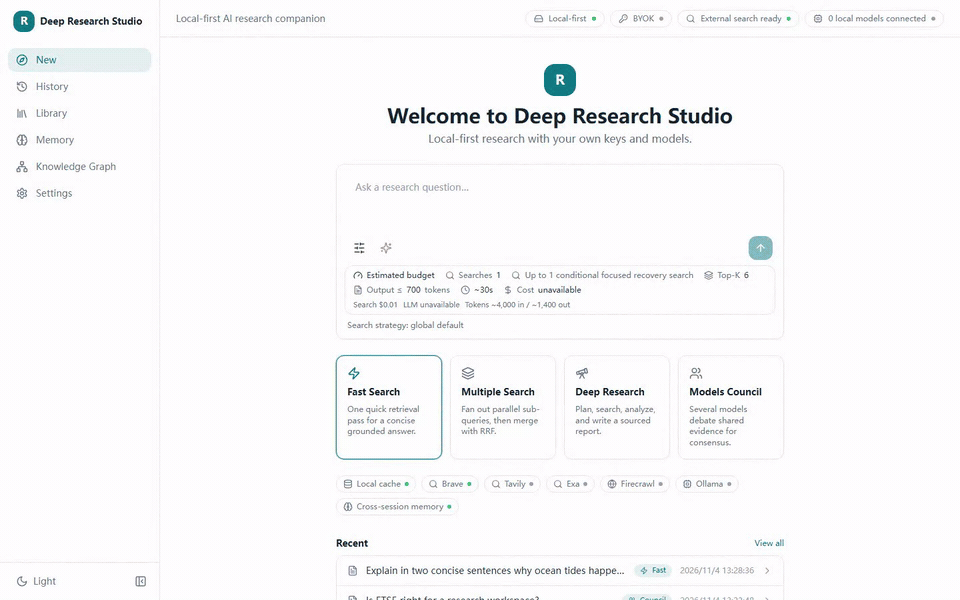
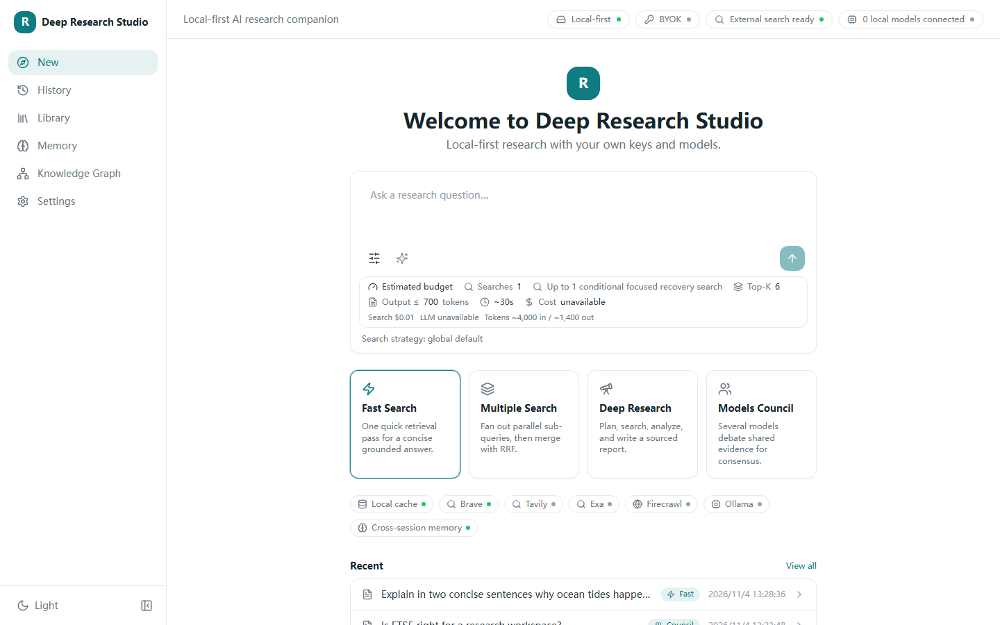
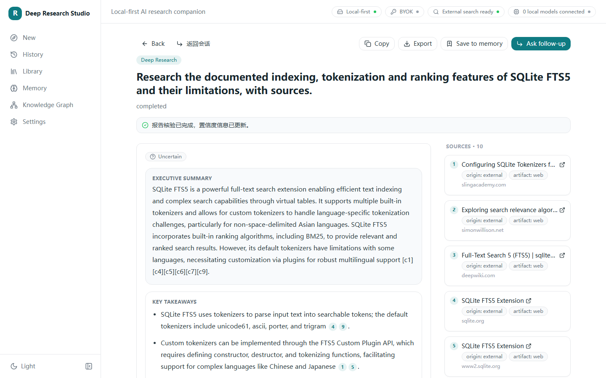
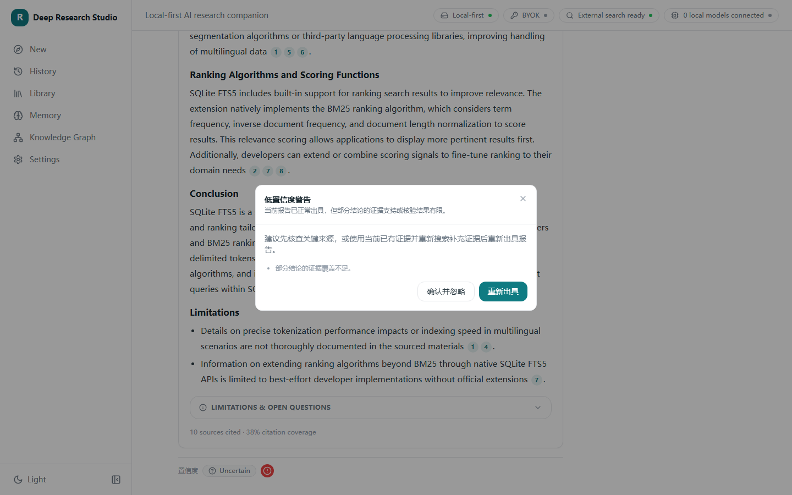
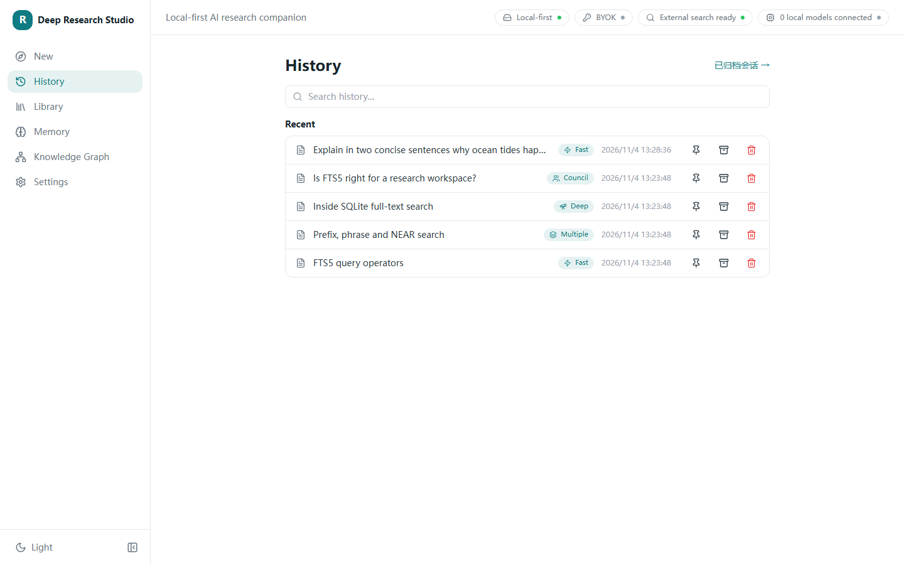
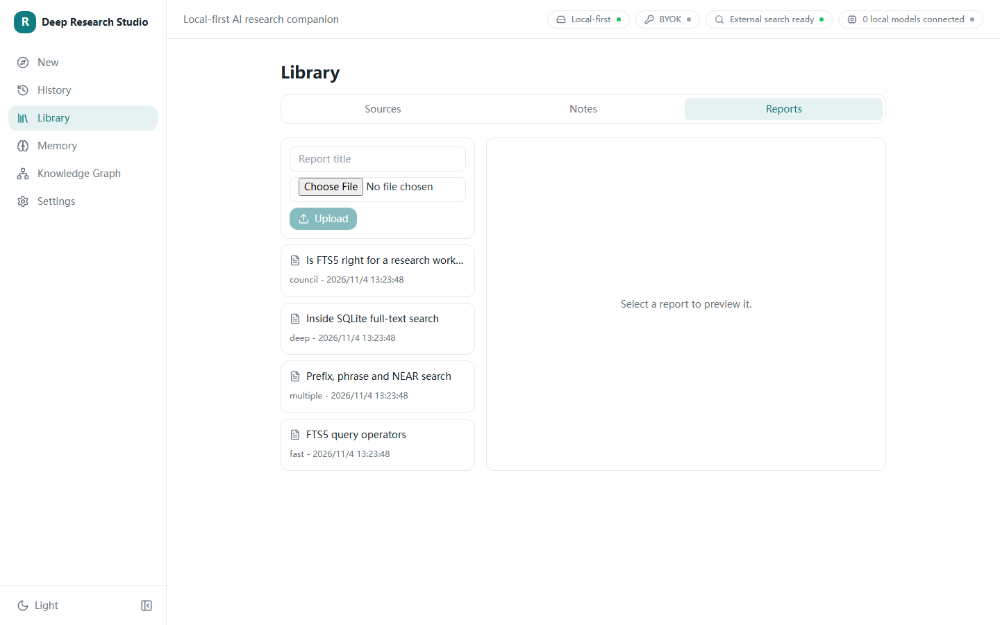
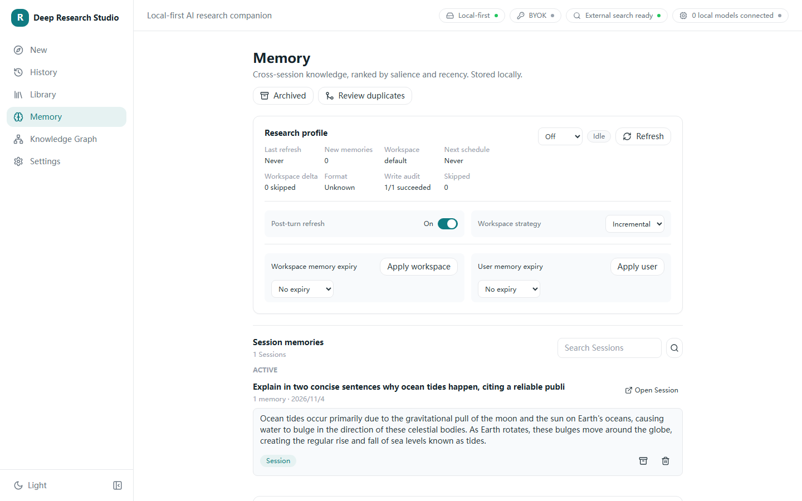
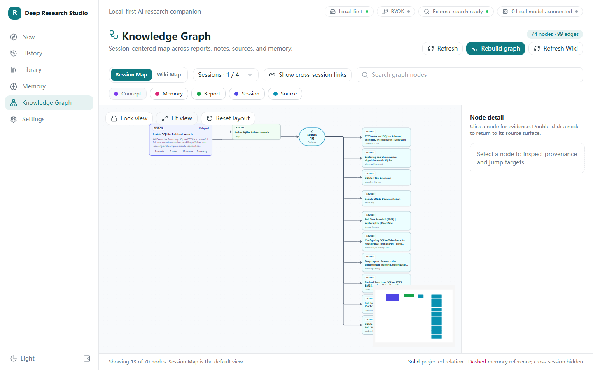
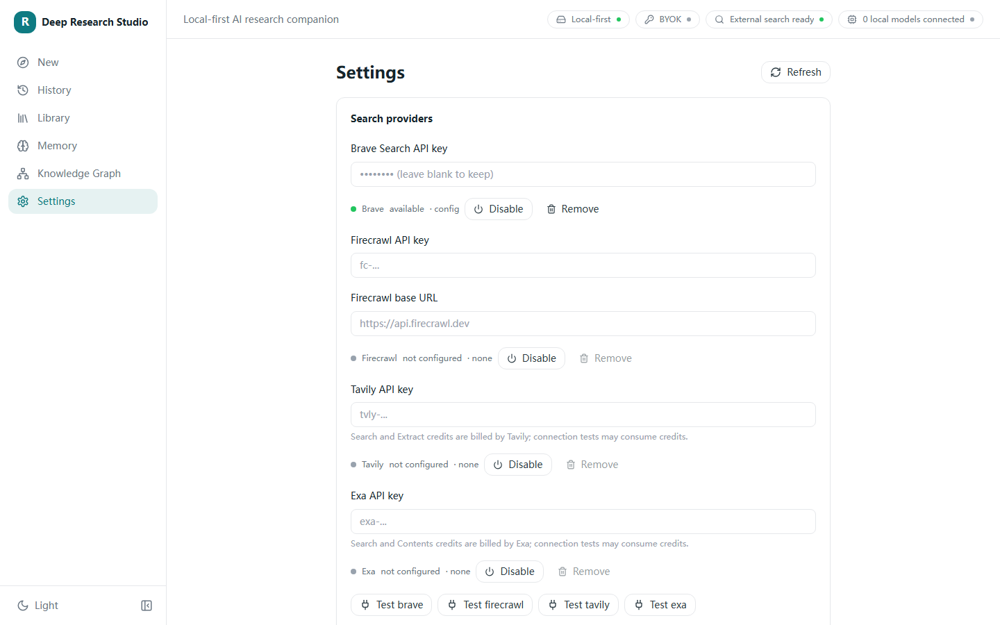
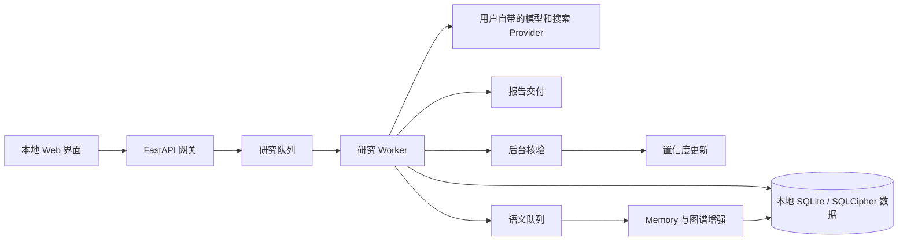

<div align="center">

[English](README.md) · [简体中文](README.zh-CN.md)


# Deep Research Studio

**本地优先、自带密钥的研究工作台，支持有据可查的回答、结构化报告、记忆和知识探索。**

[](https://github.com/Moonaria123/Deep-Research-Studio/releases/latest)
[](https://github.com/Moonaria123/Deep-Research-Studio/actions/workflows/verify.yml)
[](LICENSE)
[](#功能)
[](docs/deployment.md)
[](#隐私与安全)
[](#隐私与安全)
[](https://moonaria123.github.io/Deep-Research-Studio/)

[打开界面预览 Demo](https://moonaria123.github.io/Deep-Research-Studio/) · [本地安装](docs/deployment.md) · [安全说明](SECURITY.md)

</div>

> [!NOTE]
> 线上 Demo 使用固定的脱敏结果，不含 Provider 密钥，不能调用模型或搜索服务，也不会保存访客输入。真实研究请使用本地安装。

<a href="docs/media/demo-60s.mp4">
  
</a>

*点击动图观看完整 60 秒界面演示。*

## 目录

- [为什么使用 Deep Research Studio](#为什么使用-deep-research-studio)
- [功能](#功能)
- [界面图册](#界面图册)
- [安装](#安装)
- [工作原理](#工作原理)
- [隐私与安全](#隐私与安全)
- [路线图](#路线图)
- [贡献与许可证](#贡献与许可证)

## 为什么使用 Deep Research Studio

Deep Research Studio 把研究流程集中在一个本地 Web 应用中。你可以选择研究深度，连接自己的模型和搜索 Provider，观察研究进度，核对每项主张的来源，并把报告、笔记、记忆和主题关系保留在产生它们的证据旁边。

写作完成后，报告会立即交付；核验继续在后台运行，并在完成后更新置信度。低置信度报告仍然可用：你可以查看警告、接受风险，或基于当前证据和补充搜索重新研究并出具报告。

## 功能

| 模式 | 适用场景 |
| --- | --- |
| **Fast Search** | 通过一次聚焦检索生成简洁、有来源的回答。 |
| **Multiple Search** | 并行拆分查询，再将结果合并为更广的证据视图。 |
| **Deep Research** | 经过规划、多阶段研究和分析，生成结构化报告。 |
| **Models Council** | 让多个模型基于共享证据讨论并形成共识报告。 |

第一代 Web 版本还包括：

- 报告先交付、后台核验以及实时置信度更新；
- 主张级引用、来源检查、研究进度和报告导出；
- 管理导入来源、报告和笔记的资料库；
- 会话历史、归档和追问研究；
- 可选的自动 Memory 写入与语义召回；
- 从本地研究数据生成的会话图谱和 Wiki 风格知识图谱；
- 本地 Provider、检索、上下文预算、Memory 和图谱设置；
- 加密 Provider 凭据库和默认仅本机访问的部署方式。

## 界面图册

<details open>
<summary><strong>发起研究</strong></summary>



在同一工作区选择模式、证据范围、Memory 和模型选项。
</details>

<details>
<summary><strong>阅读有来源和置信度的报告</strong></summary>



报告出具后即可阅读；后台核验完成后，可继续检查引用和置信度详情。


</details>

<details>
<summary><strong>返回既有研究</strong></summary>



固定、归档、恢复或继续既有会话。
</details>

<details>
<summary><strong>管理来源、报告和笔记</strong></summary>


</details>

<details>
<summary><strong>检查和管理 Memory</strong></summary>


</details>

<details>
<summary><strong>探索主题关系</strong></summary>


</details>

<details>
<summary><strong>配置本地 Provider 和研究行为</strong></summary>


</details>

## 安装

Deep Research Studio 提供两种本地 Web 部署方式：

| 主机 | 前置条件 | 根密钥保护 |
| --- | --- | --- |
| **Windows + Docker Desktop** | Windows、Python 3.12、使用 Linux 容器的 Docker Desktop | 根密钥由当前 Windows 用户的 DPAPI 上下文保护。 |
| **原生 Linux / WSL2 + Docker** | Python 3.12、Docker Engine 和 Compose v2 | 根密钥保存在仅限文件所有者访问的 Linux 目录，并在启动时注入内存卷。 |

两种方式都从仓库源码构建 API 和 Web 镜像，把界面和 API 绑定到本机，并要求明确指定数据目录。请按[部署与恢复指南](docs/deployment.md)中的已验证命令操作。

<details>
<summary><strong>快速开始：Windows + Docker Desktop</strong></summary>

```powershell
git clone https://github.com/Moonaria123/Deep-Research-Studio.git
Set-Location Deep-Research-Studio
py -3.12 scripts\start_gen1_web.py --initialize --build --data-dir D:\DeepResearchStudioData\main
```

</details>

<details>
<summary><strong>快速开始：原生 Linux / WSL2 + Docker</strong></summary>

```bash
git clone https://github.com/Moonaria123/Deep-Research-Studio.git
cd Deep-Research-Studio
python3 scripts/start_gen1_web.py --initialize --build --data-dir "$HOME/.local/share/deep-research-studio/main"
```

</details>

首次安装使用空数据目录。启动成功后打开 <http://127.0.0.1:15175>；后续启动保留相同数据目录，省略 `--initialize` 和 `--build`。

启动后，打开启动器输出的本地 Web 地址，进入 **Settings** 添加模型与搜索 Provider，然后使用内置连接检查。凭据不会进入 Git、Compose 环境变量、镜像层或命令参数。

## 工作原理



Web 客户端连接本地 API。Redis 协调研究和语义 Worker；报告、会话、资料库、Memory 和图谱数据保存在指定的宿主机数据目录。Provider 凭据保存在独立的加密凭据库中，配置只保存引用。

## 隐私与安全

- 正式部署默认绑定 `127.0.0.1`。若确需通过网络访问，请先增加带身份验证的反向代理。
- Provider 密钥在本机输入和使用。不要提交 `.env`、配置、数据目录、根密钥、数据库或报告。
- key-holder 容器没有网络，运行时密钥通过 tmpfs 挂载给 API 和 Worker。
- Windows DPAPI 与 Linux 文件权限对持久化根密钥的保护不同。Linux `0600` 不等同于静态加密，仍建议启用全盘加密。
- 数据目录和根密钥应分别备份。已有安装缺失密钥或密钥不匹配时，应用会拒绝覆盖。
- 线上 Demo 是独立静态构建，详见其[行为与隐私边界](docs/demo-privacy.md)。

疑似漏洞请按 [SECURITY.md](SECURITY.md) 中的流程报告。

## 路线图

### 第一代维护

- 继续加强来源归属、置信度说明和研究恢复；
- 改进 Provider 兼容性、备份体验和本地部署诊断；
- 扩展无障碍、响应式界面和确定性的 Demo 覆盖；
- 在保持本地优先边界的前提下改善 Memory、检索和图谱体验。

### 计划中的下一代

- 更深入的证据关联知识导航；
- 更丰富的协作与可复用研究工作流；
- 更广的 Provider 与检索编排；
- 更清晰的长时研究控制和可观测性。

计划项只代表方向，不属于第一代 `v1.0.0` 已交付范围。

## 贡献与许可证

提交 Pull Request 前请阅读 [CONTRIBUTING.md](CONTRIBUTING.md)。请区分 mock、离线和真实 Provider 证据，不要包含本地凭据或研究数据。

Deep Research Studio 自 v1.0.0 起使用 [PolyForm Noncommercial License 1.0.0](LICENSE)。**允许许可条款范围内的非商业使用；超出许可允许用途的商业使用，须事先获得 Moonaria123 的书面授权。** 申请方式详见[许可与商业授权说明](docs/licensing.md#简体中文)。

本项目公开源代码，采用非商业许可，不属于 OSI 定义的开源许可证。**分发原版或修改版时，必须保留原作者署名及 [NOTICE](NOTICE) 中全部 `Required Notice:` 行，并一并提供许可证正文或其链接。** 第三方包和镜像保留各自条款，详见 [THIRD_PARTY_NOTICES.md](THIRD_PARTY_NOTICES.md)。

---

<div align="center">

让研究过程可检查、可恢复，并始终由用户掌控。

</div>
